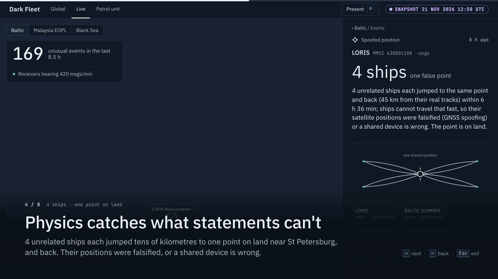

# Dark Fleet

Finds ships that hide, using physics: where a ship could have been, whether it could really have got there, and whether radar saw it.



## What it found

- **The Strait of Hormuz.** On a typical well-covered day, **41%** of the vessels radar sees around the strait have no matching location broadcast. That is the median over **59 well-covered days**, 15 August to 15 November. Source: `docs/briefings/cp1-sat-morning.md`, `docs/insights.md`.
- **GNSS spoofing near St Petersburg.** In our own Baltic recording (Saturday morning snapshot, about 9 hours), **4 unrelated ships** each jumped 40-51 km off their route to the same point on land north of St Petersburg, and back: speeds no ship can reach. A naive rule flagged 784 places, almost all ports; the out-and-back physics rule leaves one. Source: `docs/insights.md`, `data/snapshot/live_BALTIC_WATCH.json`.
- **Sanctions by IMO.** At least **21 sanctioned or shadow-fleet vessels** seen in the Baltic in about 9 hours, matched by the IMO number they broadcast (e.g. GESTIA, listed as Jaldhara). Off Singapore: the shadow-fleet tanker ROCK and the sanctioned tanker SHUSHA. IMO is a hard identity; names are not. Counts grow as the recording runs.
- **Ship-to-ship transfers.** Two real offshore transfers in our recording: CSL THAMES with FOX SUNRISE off Gothenburg (about 1 m apart, 40 minutes) and SPAR ARIES with CSM HYDRA in Singapore's anchorage (35 minutes). Both look like routine bunkering, and we label them that way. Source: `docs/insights.md`.
- **The global funnel.** **5,624** AIS gaps of 6 to 96 hours (15 Aug - 15 Nov) went to **109** with an unmatched radar detection inside the ship's possible-reach area, and then to **19** unexplained after the physics checks. The other 90 are cleared with a reason each. Source: `docs/rerank.md`, `docs/api-schema.md`.

## How sure we are

We tested our own method before trusting it.

- Radar near a dark ship is **no better than chance**: 108 real matches against 100.5 expected from time-shifted gaps, ratio **1.07** with a 95% interval of **0.91 to 1.25**. The interval includes 1, so we do not claim a radar signal.
- Locating a dark ship works: the Brownian-bridge model puts the true position above a displaced one with **AUC 0.87** (0.844 to 0.896).
- We never accuse on radar alone. Physics clears most cases with a stated reason: stationary, outside the lens at the satellite's real pass time, out of reach at class speed, or a pass outside the gap.
- The held-out test outside Brazil was inconclusive (4 real against 5.7 shifted), not evidence of a signal.
- On our own Baltic tracks: when we hide a stretch of a real ship's route, the space-time prism holds the hidden route in **62 of 66** windows (93.9%), and the jump and clone rules fire about once per 86 vessel-days on clean tracks.
- The silence rule only claims ships that were underway and only while our receivers were hearing the area. Every gap it missed in testing fell inside minutes when our own recorder heard nothing; where receivers were up, it found **55 of 55** (`docs/recall-misses.md`).

Full method, numbers and caveats: `docs/validation.md`, `docs/validation-tracks.md`.

## How it works

- **Recorder.** One aisstream WebSocket, six regions, hourly gzip files.
- **Engine.** Silences with local coverage, impossible jumps, spoofing ghost points, meetings with anchorage context, IMO watchlist.
- **Global investigation.** Global Fishing Watch gaps, a space-time prism plus Brownian bridge, and Sentinel-1 scene times.
- **Storage.** Tiger Data / TimescaleDB: our recorded positions (265,250 at the last load), radar cells and encounters as hypertables; an hourly continuous aggregate drives the recording chart on the Global screen.
- **API.** FastAPI, read-only JSON, snapshot mode for an offline demo.
- **Console.** Vite + TypeScript + MapLibre, offline basemap, presentation mode.

Architecture and the algorithm in plain words: `docs/architecture.md`.

## Run it

Python 3.12+ and Node 22+.

```sh
uv sync
cp .env.example .env                      # GFW_API_TOKEN, AISSTREAM_API_KEY, optional DATABASE_URL
uv run python scripts/record_ais.py --regions BALTIC_WATCH,MALAYSIA_EOPL,BLACK_SEA
make snapshot
DARKFLEET_DATA=data/snapshot uv run uvicorn darkfleet.api.app:app --port 8000
cd web && npm ci && npm run dev
```

Then open <http://localhost:5173> and press **P** for the presentation.

The recorder writes to `data/cache/ais/`; `make snapshot` rebuilds every demo dataset into `data/snapshot/`. `make check` runs lint, tests and the web build.

## Data and licences

- Global Fishing Watch API: CC BY-NC 4.0. Powered by Global Fishing Watch.
- aisstream.io: live AIS feed, free key, beta, no SLA.
- OpenSanctions maritime: CC BY-NC 4.0.
- Copernicus Data Space: Sentinel-1 scene metadata.
- Natural Earth: public domain basemap.

This is a non-commercial prototype. Real clients would need commercial AIS and radar feeds.

## Built at Hack Western 13

**How we built it.** AI coding agents (DeepSeek via OpenCode) wrote most of the code, working in separate lanes with one commit each. Every change was reviewed, run on real recorded data and checked in a real browser before merge, and independent reviews at checkpoints caught a false opener, a whitewashed hotspot and stale numbers. The process log is in `docs/process-audit.md`; what the build surprised us with is in `docs/insights.md`.
